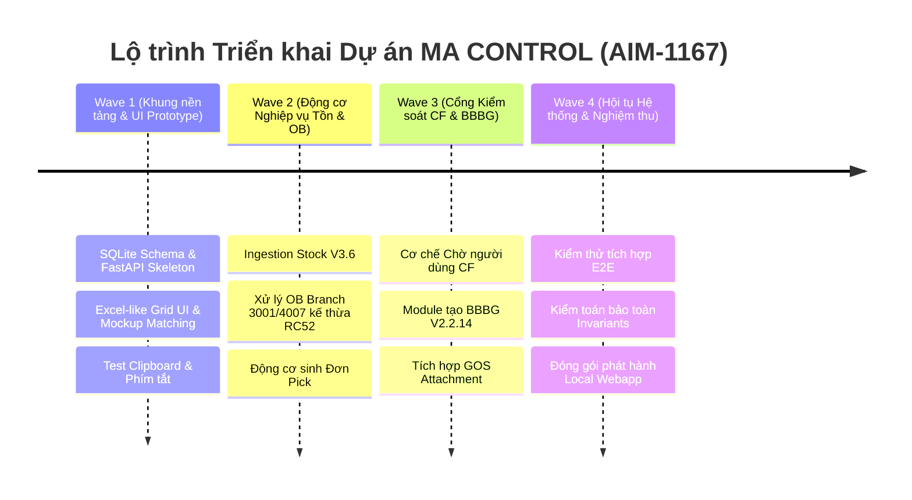

# KẾ HOẠCH PHÂN RÃ NHIỆM VỤ & ĐIỀU PHỐI ĐỘI NGŨ KỸ THUẬT (AIM-1167)

- **Mã công việc Paperclip**: `AIM-1167`
- **Dự án**: `MA CONTROL — Webapp Điều hành FG (Python + Excel-like UI)`
- **Tổng chỉ huy điều phối**: Astra — Supervisory Architect
- **Đội ngũ thực hiện**:
  * **Kai (Senior Developer)**: Trưởng kỹ thuật — Xây dựng Backend FastAPI, SQLite Schema, Lưới Excel-like Grid UI, và Tích hợp API.
  * **Luna (Code Reviewer & Auditor)**: Trưởng kiểm toán chất lượng — Thẩm định mã nguồn, rà soát đối soát logic nghiệp vụ với VBA RC52 và BBBG V2.2.14, bảo vệ bất biến.
  * **Nova (QA & Reliability Engineer)**: Chuyên trách kiểm thử độc lập — Xây dựng test suite E2E, giả lập thao tác clipboard Excel, xác minh nghiêm ngặt cổng xác nhận thủ công (Manual CF Gate).

---

## 1. PHÂN KỲ TRIỂN KHAI THEO CÁC WAVE (PHASED EXECUTION)

### Wave 1: Khởi tạo Khung Nền tảng, SQLite Schema & Giao diện Bảng Kiểu Excel (P0)
- **Mục tiêu**: Xây dựng bộ khung FastAPI hoàn chỉnh, khởi tạo CSDL SQLite với đầy đủ 7 bảng dữ liệu, hiện thực hóa giao diện webapp với bảng Excel-like Grid mượt mà bám sát 100% bản mockup.
- **Phân công nhiệm vụ**:
  * **Kai**:
    1. Tạo mô hình CSDL SQLite (`app/models/database.py`, `app/models/schemas.py`).
    2. Cấu hình FastAPI (`app/main.py`, `app/core/config.py`).
    3. Xây dựng giao diện `app/templates/index.html`, `app/static/css/style.css`.
    4. Hiện thực hóa JavaScript Grid Engine (`app/static/js/excel_grid.js`) hỗ trợ: `Ctrl+V` paste nhiều ô/dòng từ clipboard, di chuyển `Tab`/`Enter`, sửa trực tiếp ô, viền xanh lá Excel, 2 Tab nhánh `Body 3001` & `EDC 4007`, khu vực Đơn pick đã tạo.
  * **Luna**:
    1. Kiểm tra cấu trúc CSDL: Đảm bảo có đầy đủ trường phân tách vùng kho, trạng thái `WAITING_USER_CF`, và không bị thiếu thông tin truy vết.
    2. Rà soát chuẩn mã hóa UTF-8 tiếng Việt, không bị lỗi font trên Windows.
  * **Nova**:
    1. Viết kịch bản kiểm thử clipboard: Dán bảng dữ liệu 10 dòng x 6 cột từ Excel vào webapp, kiểm tra việc phân tách tab/newline chính xác 100%.
    2. Kiểm tra thao tác phím tắt `Tab`, `Enter`, `Shift+Tab`.

### Wave 2: Động cơ Nghiệp vụ Tồn kho & Xử lý OB Kế Thừa RC52 (P1)
- **Mục tiêu**: Tích hợp module phân tích tồn kho (Stock FG/MA/BODY V3.6), tích hợp nghiệp vụ xử lý Outbound Delivery theo logic đã nghiệm thu của RC52 (xóa draft 3001, bù trừ batch, phân biệt khóa STO, tối ưu VL10D cho EDC 4007), và động cơ sinh Đơn Pick.
- **Phân công nhiệm vụ**:
  * **Kai**:
    1. Dựng `app/services/stock_service.py`: Nhập dữ liệu MB52, tính toán tồn theo Plant/SLoc, xác định cờ ưu tiên xuất và kéo line.
    2. Dựng `app/services/ob_service.py`: Chuyển đổi và tinh gọn logic từ `ModuleSAP.bas` và `ModuleMain.bas` của RC52 sang Python.
    3. Dựng `app/services/pick_service.py`: Gộp dòng theo Shop/Model/Mã hàng và sinh mã đơn pick `PICK-YYYYMMDD-XXX`.
  * **Luna**:
    1. Đối soát logic từng nhánh nghiệp vụ giữa Python và mã nguồn gốc VBA RC52:
       - Nhánh 3001: Xóa draft treo, giữ lại OB hủy để resume, kiểm tra số lượng thiếu.
       - Nhánh 4007: Kiểm tra STO, batching VL10D, tránh xung đột lock chứng từ.
    2. Xác nhận không có sai lệch trong quy tắc làm tròn hoặc chuyển đổi đơn vị.
  * **Nova**:
    1. Kiểm thử mô phỏng xử lý 50 dòng OB cho cả 2 nhánh 3001 và 4007.
    2. Kiểm tra việc gộp đơn pick: Xác nhận đơn pick sinh ra chính xác số lượng mã hàng và tổng PCS.

### Wave 3: Cổng Kiểm soát Xác nhận Thủ công (CF Gate) & Tích Hợp BBBG V2.2.14 (P2)
- **Mục tiêu**: Thiết lập chốt chặn an toàn bắt buộc người dùng xác nhận thủ công (Manual CF Gate) trước khi sang bước BBBG; tích hợp bộ máy tạo BBBG, in ấn, gửi email và đính kèm attachment GOS (BBBG + VAT).
- **Phân công nhiệm vụ**:
  * **Kai**:
    1. Triển khai API và Modal kiểm tra xác nhận CF (`POST /api/pick/{order_no}/confirm`). Khóa tuyệt đối mọi tiến trình ngầm không cho tự động chuyển sang BBBG nếu chưa có `confirmed_by`.
    2. Dựng `app/services/bbbg_service.py`: Kế thừa quy tắc từ workbook `261008_BBBG_FG_V2_2_14.xlsm` (tạo số phiếu, định dạng template, xuất PDF/Excel).
    3. Dựng `app/services/attachment_service.py`: Logic đính kèm GOS chứng từ SAP (BBBG + VAT) theo chuẩn `261002_MIGO_ATT_V3_4_3.xlsm`.
  * **Luna**:
    1. Kiểm toán nghiêm ngặt: Xác minh mã nguồn hoàn toàn KHÔNG CÓ bất kỳ lời gọi API hoặc cờ tham số nào cho phép "Auto-CF" chạy ngầm.
    2. Đối soát cấu trúc đầu ra của BBBG (Số phiếu, thông tin người ký, vị trí để hàng, danh sách mã hàng) khớp 100% mẫu chuẩn V2.2.14.
  * **Nova**:
    1. Kiểm thử xâm nhập logic (Negative Testing): Thử kích hoạt tạo BBBG khi đơn pick vẫn ở trạng thái `WAITING_USER_CF` ➔ Xác nhận API trả về HTTP 400/403 Bad Request.
    2. Kiểm thử luồng hợp lệ: Thực hiện xác nhận CF trên giao diện ➔ Mở khóa tạo BBBG thành công.

### Wave 4: Tinh Chỉnh Hội Tụ, Kiểm Thử Toàn Diện & Đóng Gói Release (P3)
- **Mục tiêu**: Tối ưu hóa hiệu năng, giảm thiểu chiếm dụng bộ nhớ RAM máy trạm, chạy toàn bộ test suite hồi quy và bàn giao gói phát hành nghiệm thu cho Trợ lý Quản lý.
- **Phân công nhiệm vụ**:
  * **Kai**: Viết script khởi động một chạm `start_ma_control.bat`, tinh chỉnh asset tĩnh và cấu hình môi trường.
  * **Luna**: Xuất bản Báo cáo Thẩm định Kỹ thuật `AIM1167_LUNA_AUDIT_REPORT.md` (Audit Verdict: APPROVED).
  * **Nova**: Xuất bản Báo cáo Nghiệm thu QA `AIM1167_NOVA_QA_REPORT.md` với 100% test cases PASSED.
  * **Astra**: Tổng hợp kết quả, cập nhật trạng thái Paperclip Issue AIM-1167 và báo cáo Trợ lý Quản lý.

---

## 2. MA TRẬN PHÂN CÔNG VÀ TIÊU CHUẨN NGHIỆM THU

| Vai trò | Phụ trách chính | Trọng tâm bàn giao | Tiêu chuẩn nghiệm thu (Acceptance Criteria) |
| :--- | :--- | :--- | :--- |
| **Astra** | Supervisory Architect | Kiến trúc hệ thống, điều phối và phân rã nhiệm vụ, theo dõi tiến độ | Hồ sơ kiến trúc hoàn chỉnh, phân rã chi tiết, bảo vệ toàn vẹn luồng 5 bước |
| **Kai** | Senior Developer | Backend FastAPI, SQLite, UI Excel-like Grid, REST API | Giao diện chuẩn mockup 100%, thao tác Ctrl+V và phím tắt mượt mà, API đạt chuẩn |
| **Luna** | Quality Auditor | Review code, đối soát logic VBA RC52/V2.2.14, bảo vệ Invariants | Không có auto-CF ngầm, bảo toàn 100% logic SAP RC52, an toàn dữ liệu |
| **Nova** | QA Engineer | Test suite E2E, kiểm thử clipboard, kiểm thử cửa ngõ CF thủ công | 100% test cases PASSED, negative test chặn auto-CF thành công |
