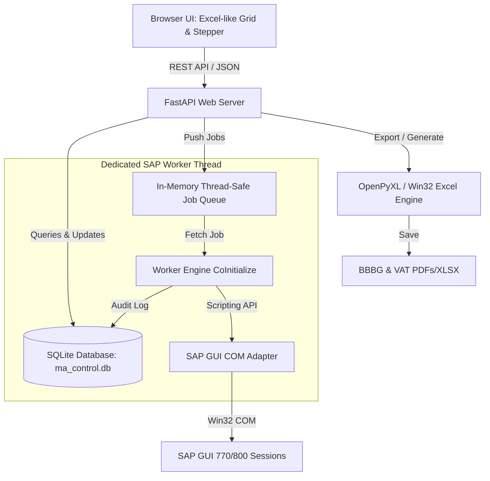

# MA CONTROL — ĐIỀU HÀNH FG: KIẾN TRÚC KỸ THUẬT & ĐẶC TẢ HỆ THỐNG

- **Mã định danh dự án**: `MA-CONTROL-FG`
- **Paperclip Issue**: `AIM-1167`
- **Tài liệu tham chiếu**: [BRIEF_MA_CONTROL_FG_WEBAPP.md](file:///G:/AI-Manager/work/manager/briefs/BRIEF_MA_CONTROL_FG_WEBAPP.md)
- **Tác giả / Tổng chỉ huy**: Astra — Supervisory Architect (AI-Manager)
- **Ngày lập**: 13/10/2026
- **Trạng thái**: Architectural Blueprint (APPROVED FOR WAVE 1 IMPLEMENTATION)

---

## 1. TỔNG QUAN HỆ THỐNG & MỤC TIÊU CỐT LÕI

Hệ thống **MA CONTROL — Điều hành FG** là ứng dụng webapp cục bộ (Local Webapp) chạy trên nền tảng **Python FastAPI + SQLite + Frontend Grid UI**, hợp nhất toàn diện 3 công cụ Excel nghiệp vụ độc lập:
1. **Stock FG/MA/BODY V3.6**: Phân tích tồn kho đa vùng (Kho Body 1003, Line Body 3003, Kho MA 3093, Line MA 3000, In Transit 3001), phát hiện cảnh báo và ưu tiên cấp phát.
2. **OB Tool V1 RC52**: Động cơ nghiệp vụ SAP xử lý Outbound Delivery (OB) cho nhánh Body 3001 (xóa draft treo, resume OB hủy, bù trừ số lượng) và nhánh EDC 4007 STO (VL10D batching, phát hiện khóa STO, tránh xung đột lock).
3. **BBBG FG V2.2.14**: Tạo biên bản bàn giao thành phẩm, in ấn, gửi email thông báo theo Shop, cập nhật sổ tổng/sổ shop, và đính kèm attachment GOS (BBBG + VAT) vào chứng từ SAP.

---

## 2. BẤT BIẾN NGHIỆP VỤ BẮT BUỘC (SYSTEM INVARIANTS)

1. **Luồng 5 bước tuần tự nghiêm ngặt**:
   ```
   [1. Tải tồn] ➔ [2. Điền OB] ➔ [3. Ra đơn pick] ➔ [4. Người dùng CF] ➔ [5. BBBG]
   ```
2. **Cổng kiểm soát xác nhận thủ công (Manual CF Gate)**:
   - **BẤT BIẾN SỐ 1**: Đơn pick sau khi sinh ra **BẮT BUỘC** ở trạng thái `CHỜ_NGƯỜI_DÙNG_CF`.
   - **BẤT BIẾN SỐ 2**: **TUYỆT ĐỐI KHÔNG TỰ ĐỘNG CF NGẦM**. Người dùng phải đi kiểm tra thực tế hàng hóa tại bãi/kho, quay lại giao diện bấm nút **"Kiểm tra CF"** / Xác nhận CF. Chỉ khi nào có kết quả CF hợp lệ mới mở khóa bước `5. BBBG`.
3. **Phân định ranh giới tồn kho (Zero Ambiguity Stock Boundaries)**:
   - Tồn kho luôn được phân tách theo bộ khóa: `Plant + SLoc + Material + Batch + Stock Type`.
   - Tuyệt đối không cộng gộp lẫn lộn giữa vùng chuyển tiếp `3093`, vùng đệm `3000`, vùng in-transit `3001` và vùng kho `1003/3003`.
4. **An toàn SAP & Cách ly COM (Thread-Isolated COM Worker)**:
   - Toàn bộ tương tác SAP GUI Scripting (`SapGuiAuto`, `pywin32`) phải được chạy trên **01 Worker Thread riêng biệt** có khởi tạo `pythoncom.CoInitialize()`.
   - Không thực thi COM trực tiếp trong HTTP request context.
   - Cơ chế Job Queue xử lý tuần tự (FIFO) chống xung đột nhiều tác vụ đồng thời trên cùng một SAP GUI Session.
5. **Idempotency & Resumability (Chống chạy lặp & Khả năng tiếp tục khi lỗi)**:
   - Trạng thái từng dòng được lưu trực tiếp vào SQLite sau mỗi bước thành công.
   - Khi gặp lỗi hoặc mất kết nối SAP, hệ thống cho phép **Resume** từ đúng điểm gián đoạn, bỏ qua các dòng đã hoàn tất.

---

## 3. CẤU TRÚC CƠ SỞ DỮ LIỆU (SQLITE SCHEMA)

Hệ thống sử dụng SQLite cục bộ tại `G:/AI-Manager/projects/ma-control/data/ma_control.db` (hỗ trợ WAL mode để đồng thời đọc/ghi không lock).

```sql
-- 1. Bảng vật tư & cấu hình đóng gói, model mapping
CREATE TABLE IF NOT EXISTS materials (
    material_code TEXT PRIMARY KEY,          -- Mã chi tiết (ví dụ: BIW73012711CA)
    description TEXT,                        -- Tên mô tả vật tư
    model TEXT NOT NULL,                     -- VF5, VF8, VF89 LIMO, VF7...
    shop TEXT NOT NULL,                      -- BODY, MA, EDC
    us_rate INTEGER DEFAULT 1,               -- Hệ số US (PCS/xe)
    std_pack INTEGER DEFAULT 1,              -- Quy cách đóng gói / thùng / rack
    created_at DATETIME DEFAULT CURRENT_TIMESTAMP
);

-- 2. Snapshot tồn kho từ SAP (MB52 / Stock V3.6)
CREATE TABLE IF NOT EXISTS stock_snapshots (
    id TEXT PRIMARY KEY,                     -- UUID snapshot
    snapshot_time DATETIME NOT NULL,
    source TEXT NOT NULL,                    -- 'SAP_MB52', 'EXCEL_IMPORT', 'MANUAL'
    total_materials INTEGER DEFAULT 0,
    total_qty REAL DEFAULT 0,
    notes TEXT
);

CREATE TABLE IF NOT EXISTS stock_items (
    id INTEGER PRIMARY KEY AUTOINCREMENT,
    snapshot_id TEXT NOT NULL,
    material_code TEXT NOT NULL,
    plant TEXT NOT NULL,                     -- 3001, 4007, 2001
    sloc TEXT NOT NULL,                      -- 1003, 3000, 3003, 3093, 4004...
    batch TEXT NOT NULL,
    stock_type TEXT NOT NULL DEFAULT 'UNRESTRICTED',
    qty REAL NOT NULL,
    unit TEXT DEFAULT 'PCS',
    priority_flag TEXT,                      -- 'PRIORITY_OUT', 'PULL_LINE', 'NORMAL'
    FOREIGN KEY (snapshot_id) REFERENCES stock_snapshots(id) ON DELETE CASCADE
);

-- 3. Bảng danh sách dòng OB cần xử lý (Excel-like Grid source)
CREATE TABLE IF NOT EXISTS ob_items (
    id TEXT PRIMARY KEY,                     -- UUID dòng OB
    branch TEXT NOT NULL,                    -- 'BODY_3001' hoặc 'EDC_4007'
    material_code TEXT NOT NULL,
    model TEXT NOT NULL,
    required_qty REAL NOT NULL,
    batch TEXT,
    shop TEXT NOT NULL,                      -- BODY, MA, EDC
    sto_number TEXT,                         -- Số STO (dành cho EDC 4007)
    ob_number TEXT,                          -- Số chứng từ OB SAP
    status TEXT NOT NULL DEFAULT 'PENDING_CHECK', -- 'PENDING_CHECK', 'READY', 'INSUFFICIENT', 'WAITING_PICK', 'PICKED'
    error_message TEXT,
    created_at DATETIME DEFAULT CURRENT_TIMESTAMP,
    updated_at DATETIME DEFAULT CURRENT_TIMESTAMP
);

-- 4. Bảng Đơn Pick đã tạo
CREATE TABLE IF NOT EXISTS pick_orders (
    pick_order_no TEXT PRIMARY KEY,          -- Định dạng: PICK-YYYYMMDD-XXX
    created_date DATE NOT NULL,
    shop TEXT NOT NULL,
    model TEXT NOT NULL,
    total_items INTEGER NOT NULL,
    total_qty REAL NOT NULL,
    status TEXT NOT NULL DEFAULT 'WAITING_USER_CF', -- 'WAITING_USER_CF', 'USER_CONFIRMED', 'REJECTED', 'HANDED_OVER'
    confirmed_by TEXT,
    confirmed_at DATETIME,
    notes TEXT,
    created_at DATETIME DEFAULT CURRENT_TIMESTAMP
);

-- 5. Chi tiết mã hàng theo Đơn Pick
CREATE TABLE IF NOT EXISTS pick_order_items (
    id INTEGER PRIMARY KEY AUTOINCREMENT,
    pick_order_no TEXT NOT NULL,
    ob_item_id TEXT NOT NULL,
    material_code TEXT NOT NULL,
    batch TEXT,
    qty REAL NOT NULL,
    ob_number TEXT,
    line_confirmed INTEGER DEFAULT 0,        -- 0: chưa kiểm tra, 1: đã kiểm tra khớp
    FOREIGN KEY (pick_order_no) REFERENCES pick_orders(pick_order_no) ON DELETE CASCADE,
    FOREIGN KEY (ob_item_id) REFERENCES ob_items(id)
);

-- 6. Hồ sơ Biên bản bàn giao (BBBG)
CREATE TABLE IF NOT EXISTS bbbg_records (
    bbbg_no TEXT PRIMARY KEY,                -- Số phiếu BBBG
    pick_order_no TEXT NOT NULL,
    handover_date DATE NOT NULL,
    sender_name TEXT NOT NULL,
    receiver_name TEXT,
    storage_bin TEXT,                        -- Vị trí để hàng
    shop TEXT NOT NULL,
    model TEXT NOT NULL,
    total_qty REAL NOT NULL,
    email_status TEXT DEFAULT 'PENDING',     -- 'PENDING', 'SENT', 'FAILED'
    print_status TEXT DEFAULT 'PENDING',     -- 'PENDING', 'PRINTED', 'FAILED'
    general_log_saved INTEGER DEFAULT 0,     -- Lưu file tổng
    shop_log_saved INTEGER DEFAULT 0,        -- Lưu file shop
    gos_bbbg_attached INTEGER DEFAULT 0,     -- GOS attachment BBBG
    gos_vat_attached INTEGER DEFAULT 0,      -- GOS attachment VAT
    created_at DATETIME DEFAULT CURRENT_TIMESTAMP,
    FOREIGN KEY (pick_order_no) REFERENCES pick_orders(pick_order_no)
);

-- 7. Nhật ký sự kiện & Kiểm toán Job (Job Events & Audit Log)
CREATE TABLE IF NOT EXISTS job_events (
    id INTEGER PRIMARY KEY AUTOINCREMENT,
    job_id TEXT NOT NULL,
    event_type TEXT NOT NULL,                -- 'CHECK_OB', 'FILL_OB', 'CREATE_PICK', 'USER_CF', 'CREATE_BBBG'
    target_ref TEXT,                         -- Số OB hoặc Số Pick Order
    status TEXT NOT NULL,                    -- 'STARTED', 'SUCCESS', 'FAILED', 'UNCERTAIN'
    evidence TEXT,                           -- Chi tiết log hoặc mã lỗi SAP
    created_at DATETIME DEFAULT CURRENT_TIMESTAMP
);
```

---

## 4. KIẾN TRÚC THÀNH PHẦN PHẦN MỀM (COMPONENT ARCHITECTURE)



### 4.1. Tầng API (FastAPI)
- `GET /api/health`: Trạng thái dịch vụ và kết nối SAP.
- `GET /api/stock/snapshot`: Lấy dữ liệu snapshot tồn kho và cảnh báo.
- `POST /api/stock/upload`: Nhập file tồn từ SAP hoặc Excel.
- `GET /api/ob/items?branch={branch}`: Lấy danh sách dòng OB theo nhánh (`Body_3001` / `EDC_4007`).
- `POST /api/ob/batch-save`: Lưu/cập nhật danh sách dòng từ bảng lưới (Excel Grid).
- `POST /api/ob/check`: Gửi job kiểm tra tồn/OB cho các dòng đã chọn.
- `POST /api/ob/fill`: Gửi job điền OB theo logic RC52.
- `POST /api/pick/create`: Sinh đơn pick từ các dòng OB đã điền hợp lệ.
- `GET /api/pick/orders`: Lấy danh sách đơn pick đã sinh.
- `POST /api/pick/{pick_order_no}/confirm`: Xác nhận thủ công từ người dùng (Manual CF).
- `POST /api/bbbg/generate`: Tạo hồ sơ BBBG, in ấn, gửi mail và đính kèm attachment GOS.

### 4.2. Giao diện Người dùng Bảng Kiểu Excel (Excel-like Grid)
- Xây dựng dưới dạng vanilla JavaScript hiện đại, nhẹ, tải trang tức thì (< 100ms), không phụ thuộc thư viện nặng bên ngoài.
- Trải nghiệm 100% như Excel:
  * Tiêu đề cột `A, B, C, D, E, F, G, H, I`.
  * Đánh số thứ tự dòng `1, 2, 3...`.
  * Hỗ trợ bắt sự kiện `paste`: Phân tích dữ liệu clipboard có dấu tab `\t` và dấu xuống dòng `\r\n` để dán chính xác vào nhiều ô và nhiều dòng liên tiếp.
  * Phím điều hướng `Tab` (sang phải), `Shift+Tab` (sang trái), `Enter` (xuống dòng dưới), `Up/Down/Left/Right`.
  * Viền chọn màu xanh lá cây mỏng kiểu Microsoft Excel (`border: 2px solid #107c41`).
  * Trực tiếp gõ phím để sửa ô (inline editing).

---

## 5. KẾ HOẠCH BẢO VỆ AN TOÀN VÀ PHỤC HỒI (RECOVERY & SAFETY)

1. **Chống bấm trùng (Debounce & Idempotency Key)**:
   Mỗi yêu cầu hành động `Điền OB` hoặc `Ra đơn pick` được gán một `Idempotency-Key` (hoặc Client Request UUID). Nếu người dùng nhấp đúp hoặc bấm lặp, máy chủ phát hiện job đang chạy và trả về trạng thái đang xử lý thay vì kích hoạt luồng SAP thứ hai.
2. **Cơ chế ghi nhận trạng thái Uncertain**:
   Nếu tiến trình SAP gặp sự cố ngắt kết nối hoặc popup không lường trước giữa bước xử lý OB, trạng thái dòng được đánh dấu `UNCERTAIN` kèm ảnh chụp màn hình/thông điệp lỗi SAP, tuyệt đối không tự động thử lại mù quáng gây trùng lặp chứng từ.
3. **Phân quyền thao tác Bước 4**:
   Bước 4 chỉ mở khóa khi người dùng click trực tiếp nút xác nhận trên UI sau khi đã xem xét đầy đủ các dòng mã hàng trong đơn pick. Nút này không có API auto-trigger từ các tiến trình nền.
